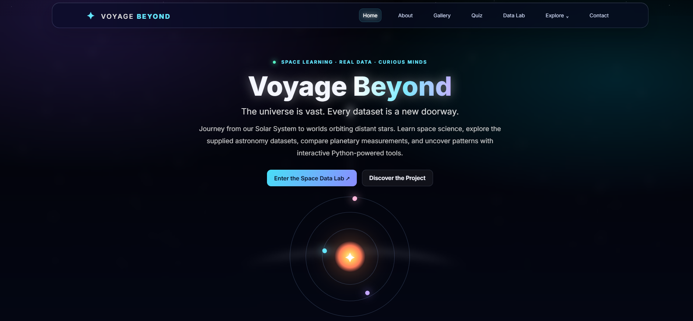
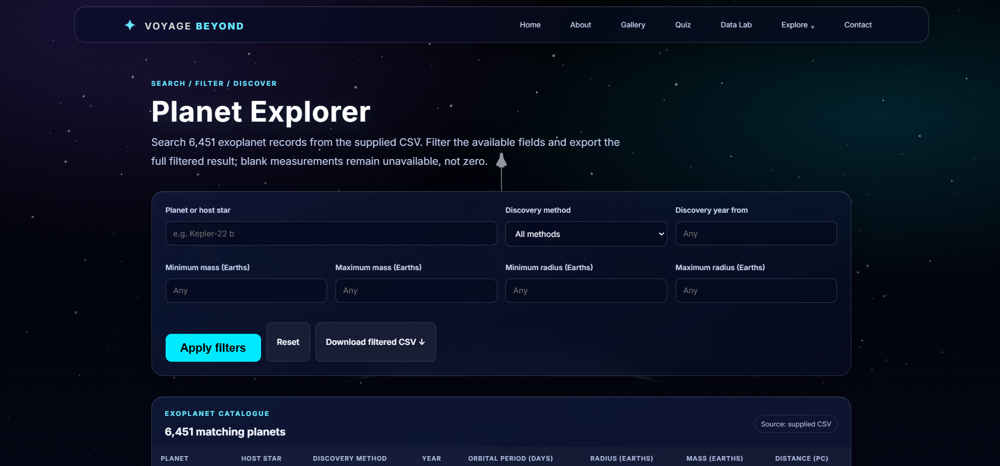
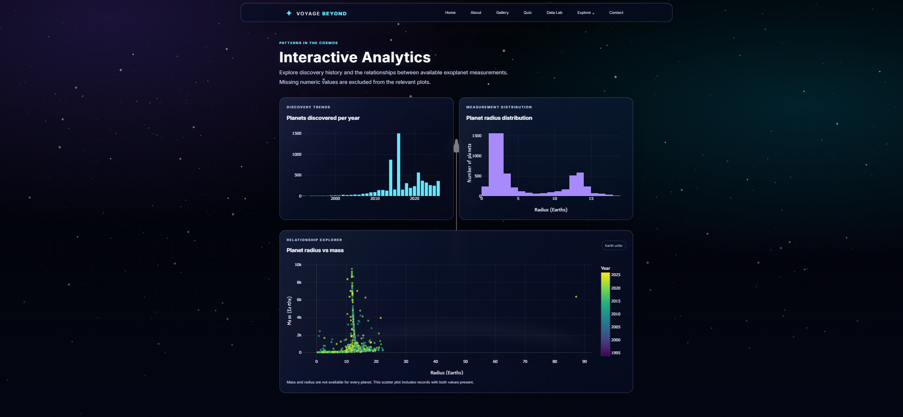
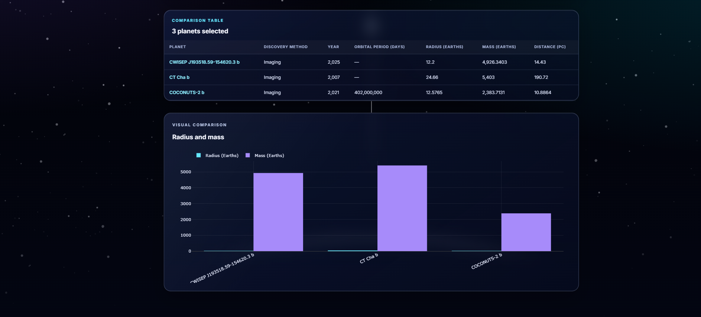

# 🚀 Voyage Beyond — Explore the Universe Through Data

<p align="center">
  
  
  
  
  
</p>

<p align="center">
  <strong>A space-themed web application that brings planetary exploration, exoplanet datasets, Python-powered analysis, and interactive visualizations together in one place.</strong>
</p>

<p align="center">
  🌌 Discover planets · 🔭 Explore exoplanets · 📊 Analyze space data · 🪐 Compare worlds
</p>

<p align="center">
  <a href="https://voyage-beyond-v2.onrender.com"><strong>🌍 Explore the Live Website</strong></a>
  &nbsp; • &nbsp;
  <a href="https://github.com/RakeshX0925/Voyage-Beyond-V2.git"><strong>💻 View Source Code</strong></a>
</p>

---

## 🌌 About the Project

**Voyage Beyond** is a Python-powered space exploration and data analysis web application designed to make astronomical data easier to explore, understand, and visualize.

The project combines a space-themed web interface with a Flask backend and real, structured planetary and exoplanet datasets. Instead of simply displaying static information, it provides tools to search for planets, compare their properties, explore dataset statistics, and understand patterns through interactive charts.

Whether you're interested in discovering distant exoplanets or exploring the properties of our Solar System, Voyage Beyond offers an interactive starting point for your journey.

## 🖼️ Project Screenshots

Take a look inside Voyage Beyond.

<!-- Upload your four screenshots to the screenshots/ folder in your GitHub repository. -->

<table>
  <tr>
    <td width="50%">
      <a href="screenshots/dashboard.png">
        
      </a>
      <p align="center"><strong>🌌 1. Space Data Dashboard</strong><br>Explore key statistics and an overview of the available space data.</p>
    </td>
    <td width="50%">
      <a href="screenshots/planet-explorer.png">
        
      </a>
      <p align="center"><strong>🔭 2. Planet Explorer</strong><br>Search and filter exoplanets using available planetary properties.</p>
    </td>
  </tr>
  <tr>
    <td width="50%">
      <a href="screenshots/analytics.png">
        
      </a>
      <p align="center"><strong>📊 3. Data Analytics</strong><br>Discover trends and patterns through interactive visualizations.</p>
    </td>
    <td width="50%">
      <a href="screenshots/planet-comparison.png">
        
      </a>
      <p align="center"><strong>🪐 4. Planet Comparison</strong><br>Compare selected planets using their available measurable properties.</p>
    </td>
  </tr>
</table>

## ✨ Features

<details open>
  <summary><strong>🌠 Space Data Dashboard</strong></summary>

  - View an overview of the available planetary and exoplanet data.
  - Explore dataset statistics and summary metrics.
  - Get a starting point for deeper exploration and analysis.
</details>

<details>
  <summary><strong>🔍 Exoplanet Explorer</strong></summary>

  - Search for exoplanets by name.
  - Filter planets using supported properties, including mass, radius, and discovery method.
  - Explore information from a dataset containing thousands of exoplanet records.
</details>

<details>
  <summary><strong>📈 Interactive Data Visualizations</strong></summary>

  - Explore discovery trends and distributions.
  - Visualize planetary properties and orbital information.
  - Use interactive charts to examine astronomical data from different perspectives.
</details>

<details>
  <summary><strong>⚖️ Planet Comparison</strong></summary>

  - Select planets for side-by-side comparison.
  - Examine available properties such as radius, mass, and orbital characteristics.
  - Understand similarities and differences between selected worlds.
</details>

<details>
  <summary><strong>🧹 Data Cleaning and Analysis</strong></summary>

  - Inspect dataset quality.
  - Identify missing values, duplicate records, and inconsistent data.
  - Use Python data-processing tools to support structured analysis.
</details>

<details>
  <summary><strong>🪐 Solar System Explorer</strong></summary>

  - Explore data about objects in our Solar System.
  - Examine available physical and orbital properties.
  - Use structured data to learn more about familiar celestial objects.
</details>

<details>
  <summary><strong>📥 Data Export and Additional Pages</strong></summary>

  - Download supported datasets or filtered results as CSV files.
  - Explore the original website pages, including Home, About, Gallery, Quiz, and Contact.
  - Experience a combination of space-themed web design and data-driven functionality.
</details>

## 🧰 Technology Stack

| Technology | Purpose |
|---|---|
| **Python** | Core application logic and data processing |
| **Flask** | Backend framework and web routing |
| **Pandas** | Dataset processing, filtering, and analysis |
| **NumPy** | Numerical operations and data analysis |
| **Plotly** | Interactive charts and data visualizations |
| **HTML5** | Web page structure |
| **CSS3** | Layout, styling, and visual design |
| **JavaScript** | Client-side interactions |
| **CSV datasets** | Structured planetary and exoplanet information |
| **Render** | Web application hosting |

## 📂 Project Structure

```text
voyage-beyond/
│
├── app.py                  # Flask application
├── requirements.txt        # Python dependencies
├── render.yaml             # Optional Render deployment configuration
├── .gitignore              # Files excluded from Git
│
├── data/
│   ├── exoplanets.csv      # Exoplanet dataset
│   └── solar_system.csv    # Solar System dataset
│
├── templates/              # HTML templates
│
├── static/
│   ├── css/                # Stylesheets
│   ├── js/                 # JavaScript files
│   └── images/             # Website images and assets
│
├── screenshots/
│   ├── dashboard.png
│   ├── planet-explorer.png
│   ├── analytics.png
│   └── planet-comparison.png
│
└── README.md               # Project documentation
```

*The structure above is illustrative. Keep the actual folder and file names from your repository if they differ.*

## 🚀 Getting Started

Want to run Voyage Beyond on your own computer? Follow these steps.

### Prerequisites

- Python installed on your system
- Git installed on your system
- A web browser

### 1. Clone the repository

```bash
git clone YOUR_GITHUB_REPOSITORY_URL
```

### 2. Navigate to the project directory

```bash
cd voyage-beyond
```

### 3. Create a virtual environment (recommended)

```bash
python -m venv .venv
```

Activate it on Windows:

```powershell
.venv\Scripts\activate
```

On macOS or Linux:

```bash
source .venv/bin/activate
```

### 4. Install dependencies

```bash
pip install -r requirements.txt
```

### 5. Run the application

```bash
python app.py
```

### 6. Open the website

Visit the following address in your browser:

```text
http://127.0.0.1:5000
```

You're ready to begin exploring! 🚀

## ☁️ Deployment

Voyage Beyond is hosted on **Render**.

🌍 **Live Website:** [Open Voyage Beyond](https://voyage-beyond-v2.onrender.com)

The deployed application uses a Python environment, installs the dependencies listed in `requirements.txt`, and starts the Flask application with a production WSGI server.

> Note: Free hosting may have usage limits and can temporarily sleep during periods of inactivity.

## 🎯 Project Goals

- Make planetary and exoplanet data easier to explore.
- Demonstrate how Python can power an interactive web application.
- Combine data cleaning, filtering, comparison, and visualization in one project.
- Present scientific information through an accessible and engaging interface.
- Apply practical skills in Python development, web technologies, and data analysis.

## 🔮 Future Improvements

Potential enhancements for future versions include:

- 🌍 More advanced planet filtering and search.
- 🛰️ Additional astronomical datasets and data sources.
- 📊 Expanded analytics and visualization options.
- 🪐 More detailed planet profiles and comparisons.
- 📱 Further improvements to the mobile experience.
- 🌌 More interactive space exploration experiences.

## 📚 What This Project Demonstrates

Voyage Beyond brings together several practical development concepts:

- Building a web application with Flask.
- Working with structured datasets using Pandas and NumPy.
- Creating interactive visualizations with Plotly.
- Designing a frontend with HTML, CSS, and JavaScript.
- Organizing a Python project for GitHub.
- Deploying a web application to a hosting platform.

## 🤝 Contributions

Suggestions, feedback, and improvements are welcome.

If you find an issue or have an idea for a new feature, feel free to open a GitHub issue or submit a pull request.

## 👨‍🚀 Author

**YOUR NAME**

GitHub: [RakeshX0925](https://github.com/RakeshX0925)

---

<p align="center">
  <strong>✨ The universe is vast. Let data be your guide. ✨</strong>
  <br>
  <em>Keep exploring. Keep discovering. Voyage Beyond. 🚀</em>
</p>
